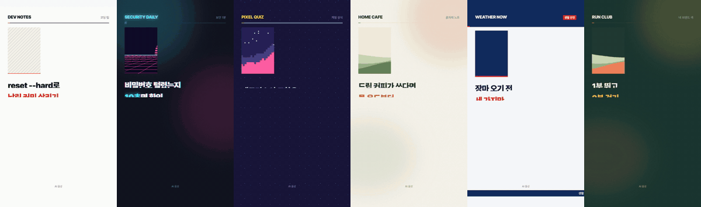

# open-shorts

**쇼츠 자동화, 돈 주고 배우지 마세요.** 주제 한 줄을 말하면 Claude Code 가 자료를 찾고, 대본을 쓰고, 목소리·자막·효과음을 넣어 세로 쇼츠 mp4 를 만듭니다. 전부 오픈소스(MIT)이고 기본 목소리도 무료라, 스킬에 드는 돈은 없습니다. (Claude Code 를 쓰려면 Claude 유료 요금제나 API 결제는 필요합니다.)

> **처음이세요?** 터미널 여는 법부터 첫 영상까지 따라 하는 [초보자 안내서](docs/GUIDE.md)가 있습니다.



> 위 여섯 화면은 모두 이 저장소 `examples/` 의 spec 으로 렌더한 영상입니다. 왼쪽부터 지면(코딩 팁) · 네온(보안) · 아케이드(게임 퀴즈) · 차분(홈카페) · 뉴스(생활 안전) · 사용자 색(러닝 클럽).

## 무엇을 하나

```
"비밀번호 유출 확인하는 법으로 쇼츠 만들어 줘"
  → 웹에서 자료 찾기 · 공식 출처로 사실 확인
  → 대본 (해요체, 40~50초)
  → 읽는 소리 변환   3D → 쓰리디, SSH → 에스에스에이치, 10월 → 시월, 3개 → 세 개
  → 무료 음성 (edge-tts) + 낱말 단위 시각
  → 주제에 맞는 테마 (보안이면 네온 + 글리치 전환 + 신스 효과음)
  → 1080×1920 mp4 + 자막 srt + 제목·설명란·고정 댓글
```

- **어떤 주제든** — 기술·게임·요리·생활·경제. 주제에 맞춰 화면과 소리를 고릅니다.
- **테마 5종 + 사용자 테마** — 색·글꼴·효과음 묶음을 spec 한 곳에서 바꿉니다. 내 채널 색과 글꼴로 맞출 수 있어요.
- **효과음 32종을 코드로 합성** — 종이 넘김, 글리치, 8비트 동전, 물방울, 방송 스팅어… 음원 파일이 없어 라이선스 걱정이 없습니다.
- **한국어 읽기를 챙깁니다** — 음성 엔진은 영어·숫자를 제멋대로 읽습니다("3D"를 "삼디"로). `speakable.py` 가 개발자가 실제로 읽는 소리로 바꾸고, 자막은 원래 표기("3D", "SSH", "2.1.312")로 되돌립니다. 세는 말(세 개·스무 명)과 한자어(삼십 일·오십 퍼센트), 유월·시월까지 구분합니다.
- **AI 말투 점검** — "~를 통해", "X가 아니라 Y", 줄표 이어 붙이기 같은 번역투·상투구를 대본 단계에서 잡습니다.
- **웹 모션 그래픽** — 화면을 HTML/CSS/SVG 로 짜고 헤드리스 Chrome 이 프레임마다 시각을 맞춰 캡처합니다. 줄마다 마스크에서 올라오는 제목, 말하는 낱말까지 켜지는 자막, 그려지는 괘선·체크·취소선, 스프링으로 튀어나오며 세는 숫자, 3D 카드 넘김, 테마별 전환(페이지 덮기·글리치·픽셀·블러·방송 막대). 같은 시각이면 언제나 같은 프레임이라 결과가 흔들리지 않습니다.
- **렌더는 내 컴퓨터에서** — 50초 영상이 M4 Pro 맥북에서 1분 안팎(직접 잰 값 60초). Chrome 이 없으면 `--simple` 로 가벼운 PIL 엔진을 씁니다(15초 안팎).

## 설치

필요한 것: [Claude Code](https://claude.com/claude-code), `ffmpeg`, [`uv`](https://docs.astral.sh/uv/), Chrome (맥: `brew install ffmpeg uv`). 하나씩 따라 하려면 [초보자 안내서](docs/GUIDE.md).

**플러그인으로** (Claude Code 안에서)
```
/plugin marketplace add bunhine0452/open-shorts
/plugin install open-shorts@open-shorts
```

**스킬 폴더만 복사해도 됩니다**
```bash
git clone https://github.com/bunhine0452/open-shorts
cp -r open-shorts/skills/shorts ~/.claude/skills/shorts
```

그다음 Claude Code 에서:
```
쇼츠 만들어 줘: 장마 오기 전에 집에서 챙길 것
```

## 손으로 돌리기

```bash
S=skills/shorts/scripts
uv run $S/doctor.py                                           # 설치 점검 (빠진 것과 설치 명령)
uv run $S/speakable.py examples/security-neon --write-spec   # draft.txt → narration.txt + caption_map
uv run $S/render.py examples/security-neon --still --preview  # 음성 없이 화면 먼저 (storyboard.jpg)
uv run $S/voice.py examples/security-neon --audition          # 목소리 3개 × 빠르기 3단계 샘플
uv run $S/voice.py examples/security-neon                     # 무료 음성 (edge-tts, 키 없음, 방송용 다듬기)
uv run $S/render.py examples/security-neon                    # → examples/security-neon/security-neon.mp4
bash $S/check_video.sh examples/security-neon/security-neon.mp4
uv run $S/render.py examples/git-paper --still --preview --theme arcade   # 같은 편을 다른 테마로
```

장면 종류(표지·표·체크·단계·취소선·순위·코드·화면 캡처·갤러리·끝 카드)와 spec 형식은 [`skills/shorts/references/spec.md`](skills/shorts/references/spec.md), 테마와 효과음 이름은 [`themes.md`](skills/shorts/references/themes.md), 대본·읽기 규칙은 [`writing.md`](skills/shorts/references/writing.md).

## 목소리

| 엔진 | 비용 | 쓰는 법 |
|---|---|---|
| edge-tts (기본) | 무료, 키 없음, 인터넷 필요 | `--voice ko-KR-SunHiNeural` (여) · `ko-KR-InJoonNeural` (남) · `ko-KR-HyunsuMultilingualNeural` (남) · `--rate +12%` |
| ElevenLabs (선택) | 유료 | `ELEVENLABS_API_KEY` 환경 변수 + `--engine elevenlabs --voice <id>` |

두 엔진 모두 글자·낱말 시각을 함께 받아 자막을 맞추므로 받아쓰기 모델이 필요 없습니다.

무료 목소리를 더 좋게 듣는 방법(모두 `voice.py` 에 들어 있습니다):
- `--audition` 으로 목소리·빠르기 9가지를 들어 보고 고르기. 같은 엔진이라도 목소리마다 차이가 큽니다.
- 방송용 다듬기(기본 켜짐): 웅웅거림을 자르고, 또렷함(3kHz)을 올리고, 치찰음을 줄이고, 가볍게 압축합니다. 시간은 그대로라 자막이 어긋나지 않습니다.
- `--tempo 1.08`: 엔진 빠르기 대신 만든 뒤 빠르기만 올리기. 말투가 덜 뭉개질 때가 많습니다.
- 대본 쪽: 짧은 문장, 영어·숫자는 읽는 소리로(`speakable.py`). 엔진이 머뭇거리는 곳은 대부분 긴 문장과 영어입니다.

edge-tts 는 Microsoft Edge 의 소리 내어 읽기 서비스를 쓰는 오픈소스 라이브러리입니다. 공식 API 가 아니라서 바뀌거나 막힐 수 있고, 그때는 다른 엔진을 `voice.py` 에 더하면 됩니다. 만든 음성을 영상에 쓸 때는 설명란에 "AI 음성"을 밝혀 주세요.

## 확인한 환경

- macOS (Apple Silicon)에서 만들고 돌려 봤습니다. 리눅스는 같은 파이썬·ffmpeg 라 될 것으로 보지만 직접 확인하지 않았고, 윈도우도 아직 확인하지 않았습니다. 돌려 보고 이슈로 알려 주세요.
- 코드 장면은 시스템 고정폭 글꼴(Menlo · DejaVu Sans Mono · Consolas)을 씁니다.

## 기여

- 읽는 법 사전 `READ`(`skills/shorts/scripts/speakable.py`)에 낱말을 더하는 게 가장 쉬운 기여입니다.
- 새 테마·새 효과음·새 장면 종류 PR 환영합니다. `themes.md` 끝에 더하는 법이 있습니다.

## 라이선스

코드 MIT. 글꼴 [Pretendard](https://github.com/orioncactus/pretendard)는 SIL Open Font License 1.1.

만든 곳: [비치콤버스](https://beachcombers.co.kr) — 이 저장소의 소개 쇼츠도 이 스킬로 만들었습니다.
