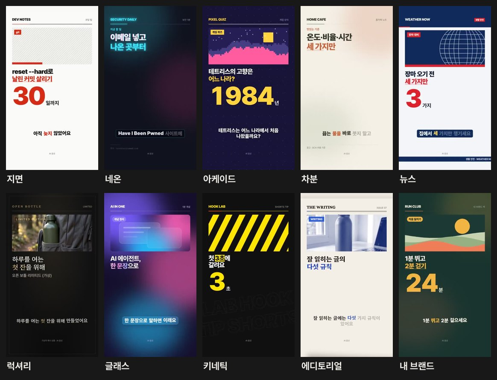
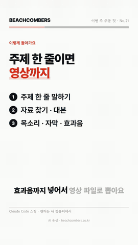
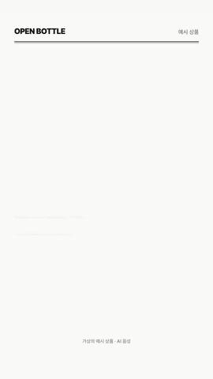
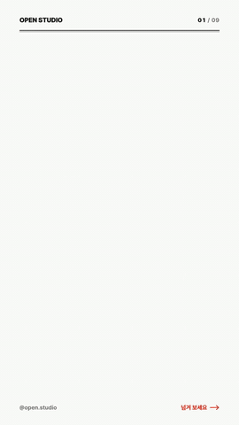
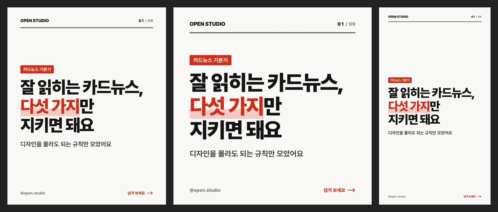
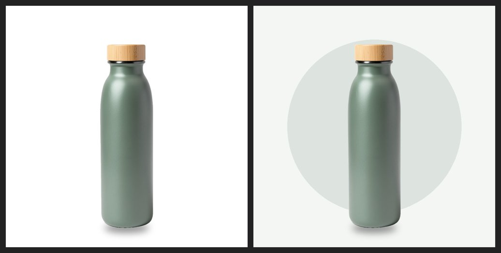
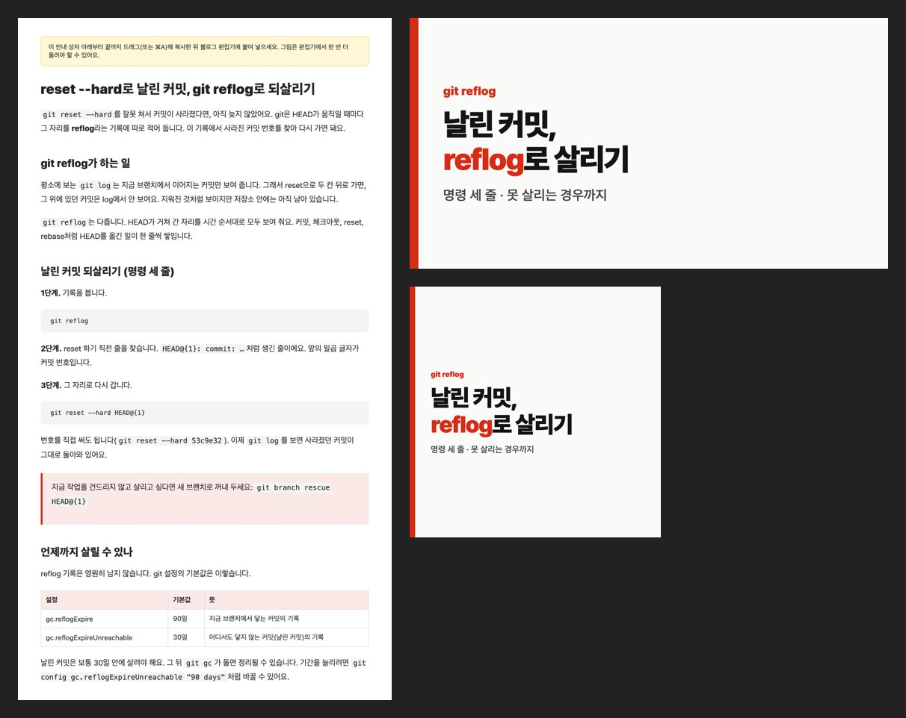
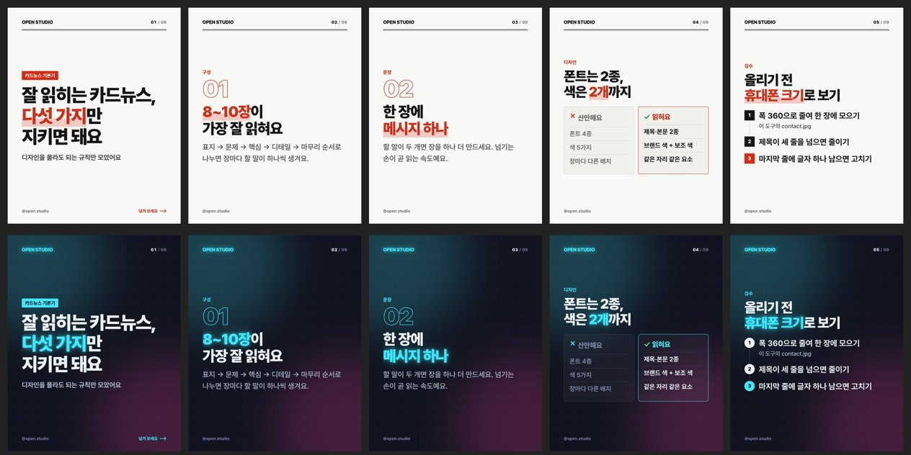
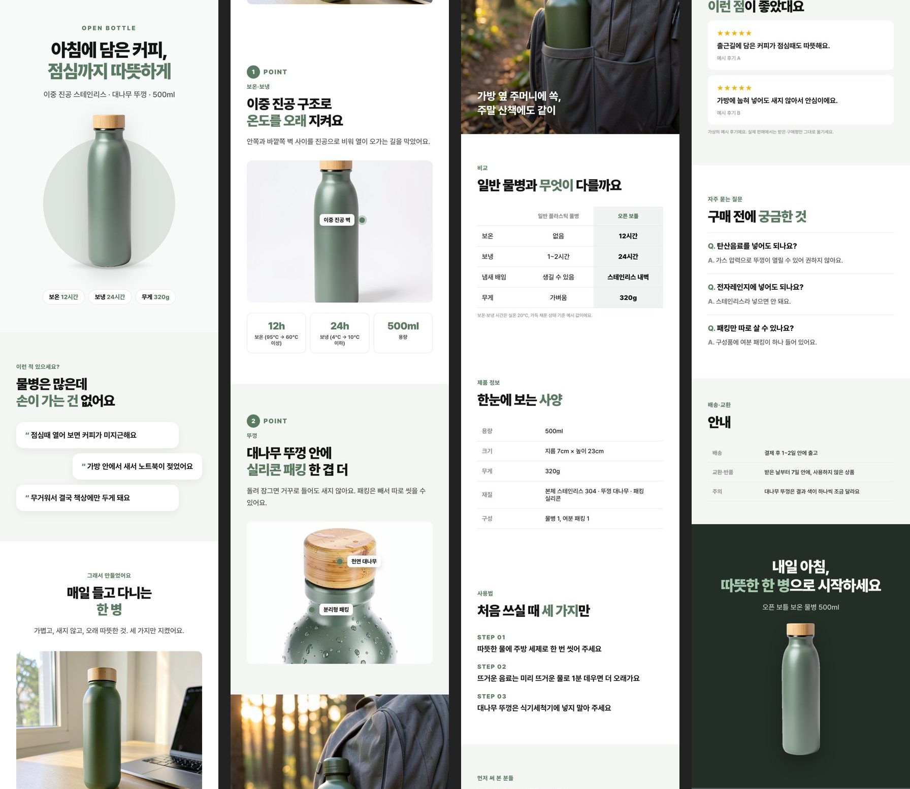

<p align="center">
  <picture>
    <source media="(prefers-color-scheme: dark)" srcset="docs/brand/wordmark-dark.png">
    
  </picture>
</p>
<p align="center"><b>AI 콘텐츠 자동화, 돈 주고 배우지 마세요.</b><br>
<a href="https://bunhine0452.github.io/open-studio/">랜딩 페이지</a> · <a href="docs/GUIDE.md">초보자 안내서</a> · <a href="https://youtube.com/shorts/lBayEKyeSgE">이 도구로 만든 쇼츠</a></p>


크몽·강의·SaaS 로 팔리는 "AI 자동화" 도구들을 같은 수준 이상으로 만들어 오픈소스(MIT)로 풉니다. 전부 [Claude Code](https://claude.com/claude-code) 스킬이라 말 한마디로 돌아가고, 렌더는 내 컴퓨터에서 합니다. 스킬에 드는 돈은 없습니다(Claude Code 는 Claude 유료 요금제나 API 결제가 필요합니다).

> **처음이세요?** 터미널 여는 법부터 첫 결과물까지 따라 하는 [초보자 안내서](docs/GUIDE.md)가 있습니다. 한눈에 보려면 **[랜딩 페이지](https://bunhine0452.github.io/open-studio/)**.

| 도구 | 이렇게 말하면 | 결과 | 비슷한 유료 상품 |
|---|---|---|---|
| **쇼츠** | "쇼츠 만들어 줘: 주제" | 1080×1920 mp4, 자막, 효과음, 업로드 문구 | 쇼츠 자동화 스킬 99,000원~ |
| **카드뉴스** | "카드뉴스 만들어 줘: 주제/링크" | 인스타 PNG(4:5·1:1·9:16), PDF, 릴스 mp4, 캡션·해시태그 | AI 카드뉴스 도구 구독, 대행 |
| **상세페이지** | "상세페이지 만들어 줘" + 사진 | 860·780·1080 긴 이미지와 조각, 대표 이미지, 누끼, HTML 원본, 과장 광고 점검 | 크몽 60,000원~, SaaS 월 29,000~149,000원 |
| **쇼핑 쇼츠** | "이 상품 쇼핑 쇼츠 만들어 줘" | 15~30초 상품 영상(누끼 무대·가격표·장점 칩), 배경음악, 자막본·무자막본, 제휴 대가성 문구 | 쇼츠 자동 프로그램 350,000원/년, SaaS 월 29,900~249,000원 |
| **블로그 글** | "이 키워드로 블로그 글 써 줘" | 조사·출처, 제목 3안·요약·소제목, 붙여 넣기용 HTML, 썸네일 2종, 워드프레스 초안, 표절·문체·광고 점검 | 블로그 자동 포스팅 99,000~1,290,000원 |

공통: 쇼츠 컨셉 9종 + 사용자 테마(지면·네온·아케이드·차분·뉴스·럭셔리·글래스·키네틱·에디토리얼), 카드뉴스 테마 5종 + 내 브랜드 색·글꼴·로고, 한국어 줄바꿈과 읽기 규칙, AI 말투 점검. 한 주제로 글 → 카드뉴스 → 쇼츠를 이어서 만들 수 있습니다.

## 실제로 만든 결과물

아래는 모두 이 저장소의 스킬로 렌더한 결과를 그대로 캡처한 거예요. 움직이는 화면과 영상은 **[랜딩 페이지](https://bunhine0452.github.io/open-studio/)** 에서 볼 수 있어요.

**같은 엔진, 열 가지 컨셉** (지면 · 네온 · 아케이드 · 차분 · 뉴스 · 럭셔리 · 글래스 · 키네틱 · 에디토리얼 · 내 브랜드)


| 쇼츠 (실제 채널 No.21) | 쇼핑 쇼츠 | 카드뉴스 → 릴스 |
|:---:|:---:|:---:|
|  |  |  |
| [유튜브에서 보기](https://youtube.com/shorts/lBayEKyeSgE) | 가상의 예시 상품 · 배경음악 포함 | 같은 세트를 9:16 영상으로 |

**카드뉴스: 한 세트를 4:5 · 1:1 · 9:16 으로 한 번에**


**상세페이지: 대표 이미지 두 가지 (흰 배경 · 브랜드 무대, 누끼 자동)**


**블로그 글: 붙여 넣기용 글 + 썸네일 1200×630 · 1000×1000**


실제로 이 도구로 운영하는 채널: [비치콤버스 쇼츠 No.21](https://youtube.com/shorts/lBayEKyeSgE) · [No.22](https://youtube.com/shorts/a5dK7I6EBjc)


## 설치

필요한 것: Claude Code, `ffmpeg`, [`uv`](https://docs.astral.sh/uv/), Chrome (맥: `brew install ffmpeg uv`). 하나씩 따라 하려면 [초보자 안내서](docs/GUIDE.md).

**플러그인으로** (Claude Code 안에서)
```
/plugin marketplace add bunhine0452/open-studio
/plugin install open-studio@open-studio
```

**스킬 폴더만 복사해도 됩니다** (도구끼리 글꼴·테마를 같이 쓰니 `skills` 를 통째로)
```bash
git clone https://github.com/bunhine0452/open-studio
cp -r open-studio/skills/* ~/.claude/skills/
```

---

# 쇼츠


> 위 여섯 화면은 모두 이 저장소 `examples/` 의 spec 으로 렌더한 영상입니다. 왼쪽부터 지면(코딩 팁) · 네온(보안) · 아케이드(게임 퀴즈) · 차분(홈카페) · 뉴스(생활 안전) · 사용자 색(러닝 클럽).

## 무엇을 하나

```
"비밀번호 유출 확인하는 법으로 쇼츠 만들어 줘"
  → 웹에서 자료 찾기 · 공식 출처로 사실 확인
  → 대본 (해요체, 40~50초)
  → 읽는 소리 변환   3D → 쓰리디, SSH → 에스에스에이치, 10월 → 시월, 3개 → 세 개
  → 무료 음성 (edge-tts) + 낱말 단위 시각
  → 주제에 맞는 테마 (보안이면 네온 + 글리치 전환 + 신스 효과음)
  → 1080×1920 mp4 + 자막 srt + 제목·설명란·고정 댓글
```

- **어떤 주제든** — 기술·게임·요리·생활·경제. 주제에 맞춰 화면과 소리를 고릅니다.
- **컨셉 9종 + 사용자 테마** — 색·글꼴·효과음 묶음을 spec 한 곳에서 바꿉니다. 내 채널 색과 글꼴로 맞출 수 있어요.
- **효과음 32종을 코드로 합성** — 종이 넘김, 글리치, 8비트 동전, 물방울, 방송 스팅어… 음원 파일이 없어 라이선스 걱정이 없습니다.
- **한국어 읽기를 챙깁니다** — 음성 엔진은 영어·숫자를 제멋대로 읽습니다("3D"를 "삼디"로). `speakable.py` 가 개발자가 실제로 읽는 소리로 바꾸고, 자막은 원래 표기("3D", "SSH", "2.1.312")로 되돌립니다. 세는 말(세 개·스무 명)과 한자어(삼십 일·오십 퍼센트), 유월·시월까지 구분합니다.
- **AI 말투 점검** — "~를 통해", "X가 아니라 Y", 줄표 이어 붙이기 같은 번역투·상투구를 대본 단계에서 잡습니다.
- **웹 모션 그래픽** — 화면을 HTML/CSS/SVG 로 짜고 헤드리스 Chrome 이 프레임마다 시각을 맞춰 캡처합니다. 줄마다 마스크에서 올라오는 제목, 말하는 낱말까지 켜지는 자막, 그려지는 괘선·체크·취소선, 스프링으로 튀어나오며 세는 숫자, 3D 카드 넘김, 테마별 전환(페이지 덮기·글리치·픽셀·블러·방송 막대). 같은 시각이면 언제나 같은 프레임이라 결과가 흔들리지 않습니다.
- **렌더는 내 컴퓨터에서** — 50초 영상이 M4 Pro 맥북에서 1분 안팎(직접 잰 값 60초). Chrome 이 없으면 `--simple` 로 가벼운 PIL 엔진을 씁니다(15초 안팎).

## 손으로 돌리기

```bash
S=skills/shorts/scripts
uv run $S/doctor.py                                           # 설치 점검 (빠진 것과 설치 명령)
uv run $S/speakable.py examples/security-neon --write-spec   # draft.txt → narration.txt + caption_map
uv run $S/render.py examples/security-neon --still --preview  # 음성 없이 화면 먼저 (storyboard.jpg)
uv run $S/voice.py examples/security-neon --audition          # 목소리 3개 × 빠르기 3단계 샘플
uv run $S/voice.py examples/security-neon                     # 무료 음성 (edge-tts, 키 없음, 방송용 다듬기)
uv run $S/render.py examples/security-neon                    # → examples/security-neon/security-neon.mp4
bash $S/check_video.sh examples/security-neon/security-neon.mp4
uv run $S/render.py examples/git-paper --still --preview --theme arcade   # 같은 편을 다른 테마로
```

장면 종류(표지·표·체크·단계·취소선·순위·코드·화면 캡처·갤러리·끝 카드)와 spec 형식은 [`skills/shorts/references/spec.md`](skills/shorts/references/spec.md), 테마와 효과음 이름은 [`themes.md`](skills/shorts/references/themes.md), 대본·읽기 규칙은 [`writing.md`](skills/shorts/references/writing.md).

## 목소리

| 엔진 | 비용 | 쓰는 법 |
|---|---|---|
| edge-tts (기본) | 무료, 키 없음, 인터넷 필요 | `--voice ko-KR-SunHiNeural` (여) · `ko-KR-InJoonNeural` (남) · `ko-KR-HyunsuMultilingualNeural` (남) · `--rate +12%` |
| ElevenLabs (선택) | 유료 | `ELEVENLABS_API_KEY` 환경 변수 + `--engine elevenlabs --voice <id>` |

두 엔진 모두 글자·낱말 시각을 함께 받아 자막을 맞추므로 받아쓰기 모델이 필요 없습니다.

무료 목소리를 더 좋게 듣는 방법(모두 `voice.py` 에 들어 있습니다):
- `--audition` 으로 목소리·빠르기 9가지를 들어 보고 고르기. 같은 엔진이라도 목소리마다 차이가 큽니다.
- 방송용 다듬기(기본 켜짐): 웅웅거림을 자르고, 또렷함(3kHz)을 올리고, 치찰음을 줄이고, 가볍게 압축합니다. 시간은 그대로라 자막이 어긋나지 않습니다.
- `--tempo 1.08`: 엔진 빠르기 대신 만든 뒤 빠르기만 올리기. 말투가 덜 뭉개질 때가 많습니다.
- 대본 쪽: 짧은 문장, 영어·숫자는 읽는 소리로(`speakable.py`). 엔진이 머뭇거리는 곳은 대부분 긴 문장과 영어입니다.

edge-tts 는 Microsoft Edge 의 소리 내어 읽기 서비스를 쓰는 오픈소스 라이브러리입니다. 공식 API 가 아니라서 바뀌거나 막힐 수 있고, 그때는 다른 엔진을 `voice.py` 에 더하면 됩니다. 만든 음성을 영상에 쓸 때는 설명란에 "AI 음성"을 밝혀 주세요.

---

# 카드뉴스



> `examples/cardnews-howto` 의 같은 cards.json 을 지면·네온 테마로 렌더한 앞 다섯 장.

```
"카드뉴스 만들어 줘: 잘 읽히는 카드뉴스 규칙"
  → 자료 조사 · 출처 확인 (링크를 주면 그 글로, 붙여 넣은 글이면 그 글만)
  → 개요 8~10장: 표지 → 문제 → 핵심 → 디테일 → 정리 → 할 일, 한 장에 메시지 하나
  → 테마 · 브랜드 키트(이름·핸들·로고·색, 한 번 저장해 계속 사용)
  → PNG 4:5 · 1:1 · 9:16 한 번에 + PDF + 휴대폰 크기 미리보기 + 릴스 mp4 + 캡션·해시태그·대체 텍스트
```

- **장 종류 11가지**: 표지(사진 배경/위 사진/글자만, 큰 숫자) · 핵심(큰 번호) · 목록 · 단계 · 체크(✓/✕) · 비교(나쁜 예 vs 좋은 예) · 숫자 하나 · 인용 · 사진 · 한눈에 정리 · 저장·공유·팔로우.
- **한국어 조판**: 낱말 단위 줄바꿈(keep-all), 제목 줄 길이 고르게(balance), 강조어 형광펜.
- **넘침 자동 처리**: 글이 넘치면 그 장만 글자를 줄여 맞추고, 그래도 넘치거나 마지막 줄에 글자 하나만 남으면 "확인 필요"로 알려 줍니다.
- **릴스까지**: 같은 세트를 9:16 으로, 장마다 제목이 올라오는 모션과 테마 효과음을 넣어 영상으로 만듭니다(9장 30초 영상 렌더 30초).

```bash
C=skills/cardnews/scripts
uv run $C/cards.py examples/cardnews-howto --preview                   # 휴대폰 크기 미리보기
uv run $C/cards.py examples/cardnews-howto --size 4:5,1:1,9:16 --reels # PNG·PDF·릴스·캡션
uv run $C/cards.py examples/cardnews-howto --preview --theme neon      # 같은 세트를 다른 테마로
```
장 종류와 cards.json 형식: [`skills/cardnews/references/layouts.md`](skills/cardnews/references/layouts.md).

---

# 상세페이지



> `examples/detail-bottle` 렌더(860 폭 한 장을 네 줄로 잘라 붙임). 가상의 상품이고 사진은 AI 로 만든 예시예요.

```
"상세페이지 만들어 줘" + 상품 정보·사진 폴더
  → 설득 흐름: 히어로 → 공감 → 해결 → 포인트(지시선·숫자 카드) → 장면 → 비교표 → 사양 → 사용법 → 후기(실제만) → 질문 → 안내 → 마무리
  → 브랜드 색 하나로 전체 색 자동 (글자 대비 4.5:1 보정) · 스타일 5가지 clean·warm·bold·dark·soft
  → 누끼(배경 제거, 오픈소스 rembg, 내 컴퓨터에서)
  → 스마트스토어 860 · 쿠팡 780 · 토스 1080 폭 한 장 + 섹션 경계 조각(JPG·WEBP) + 대표 이미지(흰 배경·브랜드 무대) + 편집용 HTML
  → 과장 광고 문구 점검 (최상급·100%·의약품 오인·인증·다이어트·출처 없는 후기)
```

```bash
D=skills/detailpage/scripts
uv run $D/detail.py examples/detail-bottle --check            # 문구 점검
uv run $D/detail.py examples/detail-bottle --preview          # 860 미리보기
uv run $D/detail.py examples/detail-bottle                    # 세 폭 + 조각 + 대표 이미지 (8초)
uv run $D/detail.py examples/detail-bottle --preview --style dark
```
섹션 종류와 문구 규칙: [`skills/detailpage/references/sections.md`](skills/detailpage/references/sections.md).

---

# 쇼핑 쇼츠

쇼츠 엔진에 쇼핑 장면 세 가지를 더했습니다: **누끼 상품이 무대 위로 떠오르는 장면**(빛이 한 번 훑고 장점 칩이 말에 맞춰 하나씩), **가격표**(정가에 줄이 그어지고 판매가가 세어 올라가고 할인율 도장), **사진 장면**(꽉 찬 사진 + 큰 글).

- 배경음악은 numpy 로 합성합니다(pop·chill·tech). 음원 파일이 없어 저작권 걱정이 없고, 말하는 동안 자동으로 줄어듭니다.
- 자막본과 무자막본(`--no-captions`)을 둘 다 뽑습니다.
- 제휴(쿠팡 파트너스 등)면 화면에 '광고' 표시, 설명란·고정 댓글에 대가성 문구를 넣습니다. 상품 페이지를 자동으로 긁거나 댓글·DM 을 자동으로 뿌리는 기능은 넣지 않았습니다(약관·스팸 정책).

```bash
S=skills/shorts/scripts
uv run $S/speakable.py examples/shop-bottle --write-spec
uv run $S/voice.py examples/shop-bottle
uv run $S/render.py examples/shop-bottle                 # 자막본
uv run $S/render.py examples/shop-bottle --no-captions   # 무자막본
```

---

# 블로그 글

```
"git reflog 키워드로 블로그 글 써 줘"
  → 검색 의도 파악 (상위 글이 무엇에 답하는지) → 자료 조사·출처 저장
  → 제목 3안 · 요약 · 소제목 구조 · 표 · 자주 묻는 질문 · 오늘 해 볼 것
  → 점검: 표절(출처 원문과 28자 이상 같은 곳) · AI 말투 · 광고 문구 · 키워드 과다 · 길이 · 구조
  → out/post.html (브라우저에서 복사 → 네이버·티스토리 편집기에 붙여 넣으면 서식 유지) · post.md · 썸네일 1200×630 / 1000×1000 · 워드프레스 초안
```
여러 계정·IP 우회·무인 대량 발행은 넣지 않았습니다. 블로그 운영 정책 위반이고 저품질로 가는 지름길이라서요.

```bash
B=skills/blog/scripts
uv run $B/blog.py check examples/blog-reflog
uv run $B/blog.py build examples/blog-reflog
```

---

## 확인한 환경

- macOS (Apple Silicon)에서 만들고 돌려 봤습니다. 리눅스는 같은 파이썬·ffmpeg 라 될 것으로 보지만 직접 확인하지 않았고, 윈도우도 아직 확인하지 않았습니다. 돌려 보고 이슈로 알려 주세요.
- 코드 장면은 시스템 고정폭 글꼴(Menlo · DejaVu Sans Mono · Consolas)을 씁니다.

## 기여

- 읽는 법 사전 `READ`(`skills/shorts/scripts/speakable.py`)에 낱말을 더하는 게 가장 쉬운 기여입니다.
- 새 테마·새 효과음·새 장면 종류 PR 환영합니다. `themes.md` 끝에 더하는 법이 있습니다.

## 라이선스

코드 MIT. 글꼴 [Pretendard](https://github.com/orioncactus/pretendard)는 SIL Open Font License 1.1.

만든 곳: [비치콤버스](https://beachcombers.co.kr). 이 채널의 쇼츠도 이 도구로 만듭니다.
